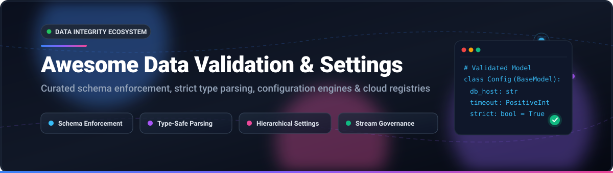

# 🌟 Awesome-Data-Validation-Settings

  

 

### ⚡ Top Data Validation, Configuration Engines & Settings Ecosystem

**Curated List of Production-Grade SaaS Platforms & Open-Source GitHub Projects**  
*Focused on Schema Validation, Strict Type Enforcement, Configuration Management & Streaming Data Integrity*  

📅 **Last updated: October 2026**

---

## 📖 Overview & SEO Summary

Welcome to the definitive catalog for **Data Validation, Schema Parsing, and Application Settings Management**. In modern backend engineering, microservices, and AI data engineering pipelines, enforcing data integrity at boundaries is mission-critical. This repository tracks both enterprise **SaaS schema registries** and high-performance **open-source libraries** enabling developers to validate, sanitize, parse, and serialize structured payloads.

Key technologies and paradigms covered include:
- 🚀 **Rust-Accelerated Type Parsers & Validators**: [Pydantic](https://github.com/pydantic/pydantic), [msgspec](https://github.com/jcrist/msgspec)
- 📜 **Declarative Schemas & Class Modelers**: [Marshmallow](https://github.com/marshmallow-code/marshmallow), [Attrs](https://github.com/python-attrs/attrs), [cattrs](https://github.com/python-attrs/cattrs), [Schematics](https://github.com/schematics/schematics), [Colander](https://github.com/Pylons/colander)
- 🗂️ **Standard-Compliant JSON Schema Engines**: [jsonschema](https://github.com/python-jsonschema/jsonschema), [Fastjsonschema](https://github.com/horejsek/python-fastjsonschema)
- ⚙️ **Hierarchical Configuration & Settings Managers**: [Dynaconf](https://github.com/dynaconf/dynaconf), [Hydra](https://github.com/facebookresearch/hydra), [Pydantic-Settings](https://github.com/pydantic/pydantic-settings)
- 📊 **Tabular & DataFrame Quality Frameworks**: [Great Expectations](https://github.com/great-expectations/great_expectations), [Pandera](https://github.com/unionai-oss/pandera), [Soda Core](https://github.com/sodadata/soda-core)
- ☁️ **Managed Cloud Schema Registries**: Confluent Cloud, AWS Glue Schema Registry, Azure Event Hubs Schema Registry

Contributions are warmly welcomed! Please review the [How to Contribute](#-how-to-contribute) guidelines.

---

## 📑 Table of Contents

- [📊 Sector Overview & Market Dynamics](#-sector-overview--market-dynamics)
- [☁️ SaaS/Hosted Platforms](#️-saashosted-platforms)
- [💻 Open-Source GitHub Projects](#-open-source-github-projects)
  - [🏆 High-Performance Type Parsers & Schema Validators](#-high-performance-type-parsers--schema-validators)
  - [⚙️ Application Configuration & Settings Management](#️-application-configuration--settings-management)
  - [📈 Data Pipeline, DataFrame & Table Quality Engines](#-data-pipeline-dataframe--table-quality-engines)
- [🤝 How to Contribute](#-how-to-contribute)
- [💖 Support](#-support)
- [⭐ Star History](#-star-history)
- [⚖️ Disclaimer](#️-disclaimer)

---

## 📊 Sector Overview & Market Dynamics

The global data quality and data validation software market is valued at approximately **$2.7B – $3.3B** and is projected to expand toward **$5.0B – $7.4B** at a ~13%–18% CAGR, fueled by real-time streaming architectures, event-driven data lakes, and generative AI data readiness initiatives. The sector is **moderately fragmented**: hyper-scale cloud providers and enterprise infrastructure conglomerates command substantial enterprise share for centralized stream governance, while specialized cloud-native vendors and an active open-source ecosystem capture application-level validation, developer workflows, and local runtime parsing.

---

## ☁️ SaaS/Hosted Platforms

The table below highlights leading hosted platforms for centralized schema governance, contract enforcement, and streaming data registries. Entries are sorted descending by parent company scale (valuation / market capitalization).

| Platform | Provider / Parent | Company Size (Valuation / Revenue) | Starting Paid Tier Pricing | Free Tier / Free Trial Limits | Description & Best For |
| :--- | :--- | :--- | :--- | :--- | :--- |
| **[Azure Schema Registry](https://learn.microsoft.com/en-us/azure/event-hubs/schema-registry-overview)** | Microsoft | **$3.9T+ Market Cap** (~$332B Ann. Revenue) | **$0.03/hour** per Throughput Unit (~$22.32/month) via Event Hubs Standard tier (plus $0.028 per million ingress events) | **30-Day Free Trial** with $200 Azure credits; no permanently free standalone tier (requires Event Hubs Standard or higher) | Managed schema registry for Apache Avro/JSON Schema within Azure Event Hubs; best for enterprise architectures on Azure. |
| **[AWS Glue Schema Registry](https://aws.amazon.com/glue/)** | Amazon (AWS) | **$2.7T+ Market Cap** (~$776B Ann. Revenue) | **$1.00 per 100,000 objects/requests per month** after free tier (schema registry feature itself incurs $0 additional fee) | **Always Free** up to **1,000,000 stored objects** and **1,000,000 requests/month** via AWS Glue Data Catalog free tier | Centralized schema registry integrated with Amazon MSK, Kinesis, and Glue Data Catalog; best for AWS-native event pipelines. |
| **[Confluent Cloud Schema Registry](https://www.confluent.io/confluent-cloud/)** | Confluent (IBM) | **$11.0B Acquisition Valuation** (~$1.17B Revenue) | **$1.00/hour per environment** (~$730/month) on Stream Governance Advanced tier (or $0.002/schema/hour overage on Essentials) | **Always Free** up to **100 schemas per environment** on Stream Governance Essentials plan (with 10 exporters and basic lineage) | Industry-standard schema registry for Apache Kafka, Avro, Protobuf, and JSON Schema; best for cross-cloud Kafka event streaming. |

---

## 💻 Open-Source GitHub Projects

The open-source projects below are sorted in **descending order by GitHub star count**. Each project includes a star badge linking directly to its stargazers page.

### 🏆 High-Performance Type Parsers & Schema Validators

1. **[Pydantic](https://github.com/pydantic/pydantic)**   
   **Data parsing and validation using Python type hints** (MIT) — **the most widely used data validation library for Python** with **25.4M downloads/day**. **The performance leader** — since **Pydantic V2**, core validation logic is written in **Rust** (`pydantic-core`), delivering a **5x to 20x performance increase** over V1.  
   - **Benchmark results**: **20,762 validations/second** on user structures, **100% error messages with field paths**.  
   - **Key features**: Type hint-driven models, automatic coercion, nested models, dataclass integration via `@pydantic.dataclasses.dataclass`, `model_fields_set` tracking, and automatic JSON Schema generation.  
   - **Best for**: High-load web services, FastAPI backends, and any Python codebase where developer velocity and type safety matter.

2. **[Marshmallow](https://github.com/marshmallow-code/marshmallow)**   
   **A lightweight library for converting complex datatypes to and from native Python datatypes** (MIT) — **the schema-first choice** with **3.7M downloads/day**.  
   - **ORM/ODM/framework-agnostic**: Schemas are declarative classes defining fields, validation rules, and serialization behavior.  
   - **Benchmark results**: **268 validations/second** on user structures with **100% error messages with field paths**.  
   - **Key strengths**: Explicit schema definitions independent of type annotations, `dump()` and `load()` serialization primitives, composable `Nested()` fields, and clean integration with Flask and Django.  
   - **Best for**: Teams requiring explicit schema contracts, complex data transformations, and decoupled serialization.

3. **[Attrs](https://github.com/python-attrs/attrs)**   
   **Python Classes Without Boilerplate** (MIT) — **the foundational class-definition library**.  
   - Provides `@define` and `@attr.s` for concise class definitions with type annotations, validators, converters, and C-speed slots.  
   - Works hand-in-hand with **cattrs** for structuring and unstructuring untrusted inputs with composable validation hooks.  
   - **Best for**: Clean domain model architectures and high-performance class definitions.

4. **[jsonschema](https://github.com/python-jsonschema/jsonschema)**   
   **Official Implementation of JSON Schema for Python** (MIT) — **the standard-compliant choice** with **13.5M downloads/day**.  
   - **Benchmark results**: **162 validations/second** on user structures with **64% error messages with field paths**.  
   - **Key strengths**: Strict adherence to JSON Schema specifications (Draft 3 through 2020-12), language-agnostic schema portability, and extensive validator pluggability.  
   - **Best for**: Cross-platform interoperability and external contract compliance.

5. **[msgspec](https://github.com/jcrist/msgspec)**   
   **High-performance serialization and validation using Python type annotations** (BSD-3-Clause) — **990K downloads/day**.  
   - **The ultra-fast alternative**: Implemented in C/Rust with native support for JSON, MessagePack, YAML, and TOML.  
   - Outperforms traditional validators on raw serialization and deserialization throughput while enforcing strict schema definitions.  
   - **Best for**: Ultra-low-latency APIs, real-time message pipelines, and high-frequency data ingestion.

6. **[Cerberus](https://github.com/pyeve/cerberus)**   
   **Lightweight, extensible schema and data validation tool for Python dictionaries** (ISC License) — **210K downloads/day**.  
   - **Dictionary-native validation**: Validates directly against dictionary rule definitions (`{'name': {'type': 'string', 'required': True}}`) without requiring class boilerplate.  
   - **Benchmark results**: **66 validations/second** on user structures with **100% error messages with field paths**.  
   - **Best for**: Quick schema checking, document parsing, and lightweight configuration auditing.

7. **[Schematics](https://github.com/schematics/schematics)**   
   **Combine types into structures, validate, and transform the shapes of data** (BSD-3-Clause).  
   - Class-based schema models featuring explicit type declarations, role-based filtering, and bidirectional conversions.  
   - **Best for**: Legacy application upgrades and explicit data-shape transformations.

8. **[Voluptuous](https://github.com/alecthomas/voluptuous)**   
   **Python data validation library for external payloads** (BSD-3-Clause) — **198K downloads/day**.  
   - **Pythonic schema syntax**: Validates incoming data using expressive literals (`Schema({'name': str, 'age': int})`).  
   - Widely adopted across projects like Home Assistant for configuration and integration validation.  
   - **Best for**: Command-line arguments, user config files, and nested mapping validation.

9. **[cattrs](https://github.com/python-attrs/cattrs)**   
   **Complex structuring and unstructuring of attrs and dataclass objects** (MIT) — **2.1M downloads/day**.  
   - Converts untrusted dictionaries and primitive data into typed data structures and back with extensible converter hooks.  
   - **Best for**: Composable serialization architectures built on Python dataclasses or attrs.

10. **[Fastjsonschema](https://github.com/horejsek/python-fastjsonschema)**   
    **Fast JSON Schema validation for Python via code compilation** (BSD-3-Clause).  
    - Compiles JSON Schema specifications directly into optimized Python code, delivering order-of-magnitude faster validation than interpreted alternatives.  
    - **Best for**: High-throughput JSON Schema contract checking.

11. **[Colander](https://github.com/Pylons/colander)**   
    **Simple schema validation and deserialization library from the Pylons ecosystem** (BSD-derived).  
    - Provides flexible schema nodes capable of validating and deserializing form submissions, strings, and mappings.  
    - **Best for**: Pyramid applications and Pylons-based web forms.

12. **[Valideer](https://github.com/podio/valideer)**   
    **Lightweight data validation and adaptation Python library** (MIT).  
    - Minimalist functional validator emphasizing concise schema declarations and zero runtime dependencies.  
    - **Best for**: Lightweight scripts and simple parameter adaptation.

---

### ⚙️ Application Configuration & Settings Management

1. **[Hydra](https://github.com/facebookresearch/hydra)**   
   **A framework for elegantly configuring complex applications from Meta Research** (MIT).  
   - Hierarchically composes configurations dynamically via YAML and command-line overrides; integrates with OmegaConf for strict typing.  
   - **Best for**: Machine learning experiments, research frameworks, and modular production applications.

2. **[Dynaconf](https://github.com/dynaconf/dynaconf)**   
   **The dynamic configuration management system for Python** (MIT).  
   - Supports multi-file formats (TOML, YAML, JSON, INI, `.env`), multi-environment layering (`development`, `staging`, `production`), secret vaults, and built-in type validation.  
   - **Best for**: 12-factor apps, Flask, Django, and cloud-native services needing multi-layered configuration.

3. **[Pydantic-Settings](https://github.com/pydantic/pydantic-settings)**   
   **Settings management using Pydantic** (MIT).  
   - Seamlessly loads and type-checks environment variables, `.env` files, secrets directories, and nested settings with full Pydantic V2 performance.  
   - **Best for**: Modern Python microservices, containerized deployments, and FastAPI settings.

---

### 📈 Data Pipeline, DataFrame & Table Quality Engines

1. **[Great Expectations (GX)](https://github.com/great-expectations/great_expectations)**   
   **Always know what to expect from your data** (Apache-2.0).  
   - Industry-standard framework for data assertion, automated profiling, and self-updating documentation ("Data Docs") across SQL, Spark, and Pandas.  
   - **Best for**: Production data pipelines, ETL validation, and data warehouse quality auditing.

2. **[Pandera](https://github.com/unionai-oss/pandera)**   
   **Statistical data validation for Pandas, Polars, and Dask DataFrames** (MIT).  
   - Provides expressive type annotations and schema definitions for tabular structures, enforcing column types, value ranges, and statistical hypotheses.  
   - **Best for**: Data science notebooks, ML preprocessing pipelines, and analytics workflows.

3. **[Soda Core](https://github.com/sodadata/soda-core)**   
   **Free, open-source command-line tool and Python library for data reliability** (Apache-2.0).  
   - Enables engineers to define data reliability checks in declarative SodaCL (Soda Checks Language) across PostgreSQL, Snowflake, BigQuery, and Athena.  
   - **Best for**: CI/CD data testing, ingestion validation, and automated data monitoring.

---

## 🤝 How to Contribute

Contributions are warmly welcomed! Help make this curated guide the most comprehensive resource on the web:

1. 🍴 Fork the repository.
2. 🌿 Create a new feature branch (`git checkout -b feature/new-validation-tool`).
3. 📝 Add your tool to `README.md` maintaining alphabetical or star-ranked placement and standard formatting.
4. ✅ Ensure description accuracy, license transparency, and official documentation links.
5. 🚀 Submit a Pull Request with a brief summary of why the library belongs on this list.

---

## 💖 Support

If you find this repository helpful, consider supporting its maintenance and continued expansion:

- ⭐ **Star this repository** to help others discover it!
- 🍴 **Fork and share** with colleagues and developer communities.
- ☕ **Buy a coffee & sponsor**: Visit the [Sponsor Dashboard](https://github.com/sponsors/ishandutta2007) to support ongoing curation and open-source tooling.

---

## ⭐ Star History

---

## ⚖️ Disclaimer

- This is a **community-curated list** — not exhaustive and not an endorsement of any commercial platform or library.
- Data validation libraries handling application data must follow security best practices, especially when validating untrusted external input.
- **The performance gap between validators is substantial.** **Pydantic** processes **20,762 validations/second** on user structures vs. **Marshmallow's 268** and **Cerberus's 66**. **Pydantic's Rust core delivers a 5-20x speedup over its V1**. However, speed should be balanced with **error message quality**, **schema expressiveness**, and **ecosystem integration**.
- **Error message localization varies critically.** **Pydantic, Marshmallow, and Cerberus** provide **100% of error messages with field paths**. **jsonschema** provides **64%**. Detailed error localization dramatically accelerates debugging nested structures.
- **Memory consumption is the hidden cost.** **Cerberus** uses **1.242 MiB relative RSS** on graph structures vs. **Pydantic's 0.012 MiB**—over 100x more memory. For high-throughput services processing millions of objects, memory footprint compounds.
- **The type-hint vs. explicit-schema distinction drives adoption.** **Pydantic** leverages Python type hints for clean code and IDE auto-completion. **Marshmallow** requires explicit schema classes, offering framework independence and granular serialization control.
- Self-hosted open-source solutions require proper dependency management and version pinning. **Validation libraries are foundational infrastructure**—breaking changes in validation behavior can cascade across applications.

---

**Made with ❤️ for backend developers, API engineers, and data practitioners building transparent data validation solutions.**  
*Let's make Data Validation & Settings more open, data-driven, and type-safe.*

